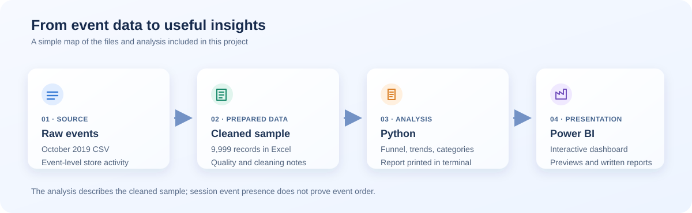
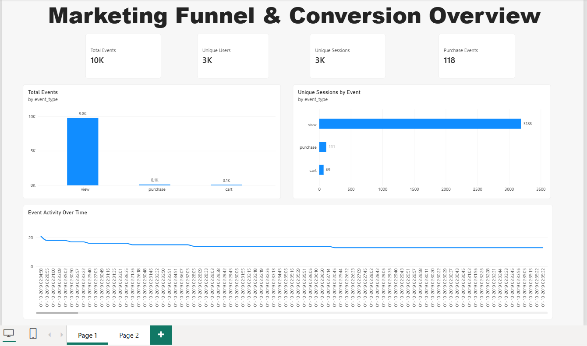
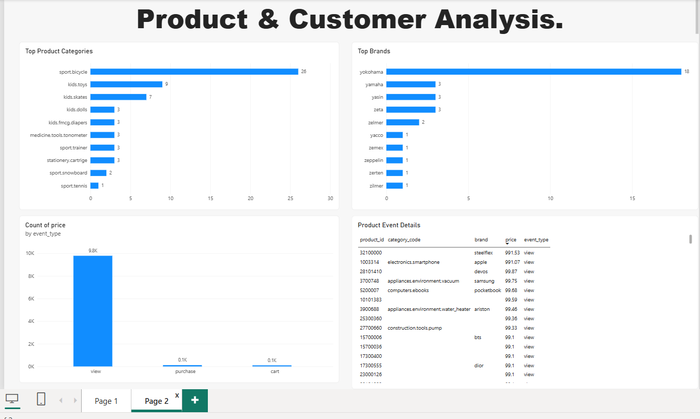

# Future Interns — Marketing Funnel Analysis

This project looks at how people interact with products in an online store: what they view, add to their carts, and purchase. It includes a Python analysis, written findings, and Power BI dashboard previews.

> **A note about the data:** The local raw CSV contains over a million rows, while the cleaned workbook contains a 9,999-record sample. The raw and cleaned customer-level data and the Power BI file are intentionally not included in this repository because they contain, or may embed, user IDs and session identifiers. The Python results described here apply to the sample only—not the full October 2019 dataset.

## What’s in the project

```text
Future_Interns_Task_3/
├── .gitignore
├── README.md
├── python/marketing_funnel_analysis.py
├── reports/
│   ├── Task_3_Phase_3_Python_Analysis_Report.docx
│   └── Task_3_Phase_3_Python_Analysis_Report.pdf
└── visuals/
    ├── marketing_funnel_overview.png
    ├── product_customer_analysis.png
    └── project_workflow.svg
```

Customer-level data files and the Power BI dashboard are kept out of GitHub. To run the analysis, provide your own authorized cleaned workbook locally; the script's default location is `data/cleaned/Task_3_Marketing_Funnel_Cleaned.xlsx`.

## How the pieces fit together



## Take a look at the dashboard

The screenshots below are previews of the Power BI report. Open the `.pbix` file in Power BI Desktop to explore the interactive dashboard.

### Marketing funnel overview



### Product and customer analysis



## Run the Python analysis

You’ll need Python 3 and the `pandas` and `openpyxl` packages. From the project folder, install them with:

```powershell
python -m pip install pandas openpyxl
```

Then run:

```powershell
python .\python\marketing_funnel_analysis.py
```

Before running, place an authorized cleaned workbook at `data/cleaned/Task_3_Marketing_Funnel_Cleaned.xlsx`, or provide its location with `--input`. The script reads the `Cleaned_Data` worksheet and prints the full analysis to the terminal. **It does not create a text report file.**

To analyze a different compatible Excel workbook, pass its path with `--input`:

```powershell
python .\python\marketing_funnel_analysis.py --input ".\path\to\another-workbook.xlsx"
```

The workbook must contain a `Cleaned_Data` sheet with these columns:

`event_time`, `event_type`, `product_id`, `category_id`, `category_code`, `brand`, `price`, `user_id`, and `user_session`.

## What the analysis covers

- Event counts and each event’s share of the sample
- Unique users, sessions, and products
- Session-level presence and overlap of view, cart, and purchase events
- Price summaries
- The most active product categories and brands
- Daily event counts
- Missing-value, duplicate-row, and other data-quality checks

## Reading the funnel carefully

The analysis groups events by session and checks whether a session contains views, cart events, or purchases. It also reports descriptive ratios, such as purchase sessions divided by view sessions.

Those ratios are **not verified step-by-step conversion rates**: finding both a view and a purchase in a session does not prove which happened first. The sample is also limited, so the results should not be generalized to all customers or the full month.

## Files and outputs

- **Raw and cleaned customer-level data:** retained locally; not published in this repository
- **Interactive Power BI dashboard:** retained locally; not published because it may contain embedded customer-level data
- **Written analysis:** PDF and Word documents in `reports/`
- **Dashboard previews and workflow picture:** `visuals/`
- **Current Python output:** printed in the terminal when the script runs
